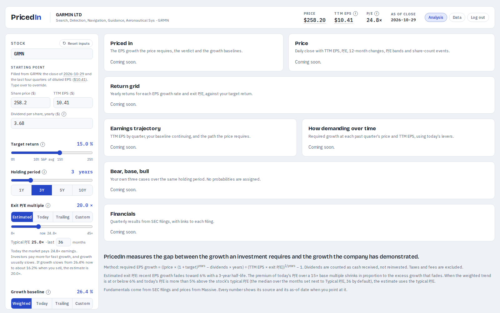

# PricedIn

PricedIn shows how much future earnings growth a stock price already assumes. It answers one question before any deep research starts: what must this company deliver for me to earn my target return, and has it ever delivered that?



## What PricedIn is

- For a US stock that files with the SEC, PricedIn calculates the **required growth**: the yearly EPS growth that turns today's price into your target return, at the P/E that you expect when you sell.
- It puts the company's own record next to that number: its recent EPS growth, its P/E history, its financials, its splits and its dividends.
- Every number carries its source and its as-of date. A figure from a filing links to that filing.
- All data is real. Earnings come from SEC filings, and prices come from Massive (formerly Polygon.io), a licensed price provider. PricedIn uses no analyst estimates and no forward P/E.

## What PricedIn is not

- It never tells you to buy or sell. It does not say what a stock is worth. It shows what must happen for an investment to succeed, so that you know which stocks deserve research.
- It is not public. v1 is a private deployment for one owner, behind a login, because the price data is licensed for personal use only (see `docs/data-sources.md`).

## Quick start

You need Docker with Compose v2, `make` and `git`. These commands start the whole stack on your machine with fixture data, so you need no API key and no network access to SEC or the price provider:

```sh
git clone https://github.com/sourcehawk/pricedin.git
cd pricedin
cp .env.example .env
make up-fixtures
make seed
```

`make up-fixtures` builds the images and starts Postgres, the API server, the scheduler, the web app and a fixture server that answers in place of SEC and Massive. The first build takes several minutes. `make seed` loads five fixture companies: NVDA, AAPL, KO, GRMN and ADM.

Then open http://localhost:3000. The API answers on http://localhost:8080.

If a port is in use, change it in `.env` and run `make up-fixtures` again. The four ports are `PRICEDIN_WEB_PORT`, `PRICEDIN_API_PORT`, `PRICEDIN_METRICS_PORT` and `PRICEDIN_DB_PORT`. For example, `PRICEDIN_WEB_PORT=3001` moves the web app to http://localhost:3001. The stack allows logins from the web port that you set.

To log in to the web app, give the stack an owner:

1. Make a hash of your password with the server image that `make up-fixtures` built. The command asks for the password two times, and prints the hash:

   ```sh
   docker run --rm -it pricedin-server:dev auth hash-password
   ```

2. Add your email address and the hash to `.env`. Put the hash in single quotes, because it holds `$` characters:

   ```sh
   PRICEDIN_OWNER_EMAIL=you@example.com
   PRICEDIN_OWNER_PASSWORD_HASH='$argon2id$v=19$m=19456,t=2,p=1$...'
   ```

3. Run `make up-fixtures` again.
4. Open the web app (http://localhost:3000, or your `PRICEDIN_WEB_PORT`). It shows the login page. Log in with that email and password.

After the login, the stock page opens. Find a fixture company, such as GRMN, in the stock search of the left panel. The left panel also holds every lever: target return, holding period, exit P/E and the growth baseline, each with a text field. The main column holds the panels. The data page (`/data`) shows how fresh the data is, lists the latest ingest runs, and loads or refreshes a company.

`make down-fixtures` stops the stack and keeps its data.

## Documentation

| Page | Read it to |
| --- | --- |
| [docs/development.md](docs/development.md) | Work on the code: tools, the local stack, tests, migrations, generated files |
| [docs/architecture.md](docs/architecture.md) | Understand the parts, the data flow, the two engines and the security model |
| [docs/data-sources.md](docs/data-sources.md) | Learn what PricedIn reads from SEC and Massive, the rules that make quarters from filings, and the limits of the data |
| [docs/api.md](docs/api.md) | Call the HTTP API with an API token |
| [docs/runbook.md](docs/runbook.md) | Deploy to Fly.io and Vercel, and operate the deployment |

The product brief is in `CLAUDE.md`, and the behavior reference is `prototype/pricedin.html`. The design decisions of v1 are in `docs/superpowers/specs/`.
