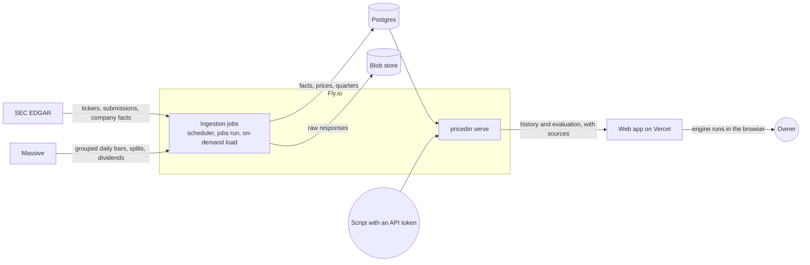

# Architecture

This page explains the parts of PricedIn, how data moves through them, and where each concern lives in the code. Read it before you change the server, the web app or the deploy settings. For the product itself, read `CLAUDE.md`. For the decisions behind this design, read `docs/superpowers/specs/2026-10-30-pricedin-v1-design.md`.

## Components

PricedIn has five parts of its own, and two external sources.

| Part | What it does | Where it runs in production |
| --- | --- | --- |
| Web app | Next.js app in TypeScript: the login page, the stock page with its levers, panels and walkthroughs, and the data page. It runs the browser copy of the calculation engine, and sends every `/api/*` request on to the server. | Vercel |
| API server | `pricedin serve`: the HTTP API, the owner login, the on-demand load of one company, and the Prometheus metrics. | Fly.io, process group `app` |
| Scheduler | `pricedin scheduler`: runs the `daily` ingestion job once a day. | Fly.io, process group `scheduler` |
| Postgres | The database: reference data, facts, prices, derived quarters, job runs, sessions and API tokens. | A managed Postgres 18, such as Neon |
| Blob store | Every raw response from SEC and Massive, kept before the jobs parse it. | Tigris (S3-compatible) on Fly.io |
| SEC EDGAR | Filings and XBRL facts. | External |
| Massive | Daily bars, splits and dividends. | External |

One Go binary, `pricedin`, holds the server, the scheduler, the jobs, the migrations and the owner tools. Each one is a subcommand. The same image runs all of them.

## Data flow

1. A job fetches a file from SEC or Massive. The client gives each response body to the recorder, which writes it to the blob store. Then the job parses the body. If the write to the blob store fails, the request fails, so the database never holds a value without its raw source.
2. The job writes the parsed rows to Postgres. Facts are append-only. An amended filing adds rows, and no row changes.
3. After facts or provider splits change, `fundamentals-rebuild` derives the fiscal quarters again and stores them in `quarterly_fundamentals`.
4. The API reads the quarters and the split-adjusted closes, and sends them to the browser as the engine input (`GET /api/v1/stocks/{ticker}/history`).
5. The browser runs the TypeScript engine on that input. A lever change recalculates the page without a request to the server.
6. Scripts can get the same output from the Go engine through `POST /api/v1/stocks/{ticker}/evaluation`.

`docs/data-sources.md` gives the rules of each source. `docs/runbook.md` gives the job schedule.

## The two engines

The calculation engine exists twice, with the same function names:

- The Go engine in `server/internal/engine` is the source of truth. The evaluation endpoint uses it, and so will the screener and the MCP tools later.
- The TypeScript engine in `web/src/engine` runs in the browser, so that a lever change updates the page at once.

Both engines run the shared cases in `testdata/engine/cases.json`: a function name, the input, the expected output and a tolerance. The expected values come from an oracle in `tools/engine-oracle/`, which runs the prototype's own math, not from either engine. `make generate-engine-cases` writes the cases again, and `make lint` fails when the committed cases differ from the oracle. A change to one engine without the other fails CI.

Both engines use fractions for rates (0.15 is 15%). A value that cannot be computed is `{"value": null, "reason": "<code>"}`, never NaN.

## Provenance

Every number in the API carries its source and its as-of date:

- An SEC value names its form, accession number, filing date and period end, and links to the filing.
- A price names the provider and the close date.
- A derived value, such as a TTM sum, lists its inputs.
- A value that the owner typed has `kind: user`.

The data keeps the history that later backtests need:

- `facts` is append-only. A trigger rejects `UPDATE`, `DELETE` and `TRUNCATE`. The quarter derivation can ignore filings after an as-of date.
- Raw closes stay as the provider sent them. A new split adds a row to `price_splits`, and the view `prices_adjusted` divides the earlier closes by it when it reads them. No price row changes for a split. (A correction from the provider does replace the old row: `docs/data-sources.md` lists this limit.)
- The blob store keeps each response under a key with its retrieval date and a hash of its body. A newer response never overwrites an older one.

## Authentication

v1 has one user, the owner. Nobody else gets an account.

- The owner's email and an Argon2id hash of the password come from the server's environment (`PRICEDIN_OWNER_EMAIL`, `PRICEDIN_OWNER_PASSWORD_HASH`).
- A login creates a session row and sets the cookie `pricedin_session` (`HttpOnly`, `Secure`, `SameSite=Lax`). The database keeps only a hash of the cookie's token.
- The web app sends `/api/*` on to the server through `web/src/proxy.ts`. For each request, it reads `PRICEDIN_API_URL` and rewrites the request to that server with `NextResponse.rewrite`. The value is read at request time, not at build time, so one image serves Compose and production. Thus the cookie belongs to the web app's own domain. The same proxy sends a visitor without a session cookie to `/login`. A forwarded request can take 150 s (`proxyTimeout` in `web/next.config.ts`), because a company load can take two minutes.
- A login, and a state-changing request with the cookie, must carry an `Origin` header from `PRICEDIN_PUBLIC_ORIGIN`.
- Scripts use API tokens in `Authorization: Bearer <token>`. `pricedin auth token create` makes one. The database keeps only its hash.
- Login attempts are limited per client address. On each `/api/*` request, the proxy of the web app removes the headers `X-PricedIn-Proxy` and `X-PricedIn-Client-IP` that the browser sent. Then it adds `X-PricedIn-Proxy` with the deploy secret `PRICEDIN_PROXY_SECRET`, and `X-PricedIn-Client-IP` with the address from Vercel's `x-real-ip` header. The server uses that address only when the secret matches (`auth.ProxyClientIP`, a constant-time comparison). Other requests, such as scripts with an API token, count against the address in `PRICEDIN_TRUSTED_PROXY_HEADER`: `Fly-Client-IP` on Fly.io. Thus a direct request to the API cannot choose its address. The secret goes only from the web server to the API, never to the browser. Compose sets no secret, so all logins in Compose share the address of the web container.

`docs/api.md` shows the requests.

## Database roles

Production uses two Postgres roles:

- The owner role owns the tables. Only `pricedin migrate` connects as this role, through `PRICEDIN_DATABASE_MIGRATE_URL`. It runs from the deploy workflow, with the URL in a GitHub secret, or from the owner's machine. The Fly app has no release command and no copy of this URL, so the app never holds the owner credentials.
- The app role owns nothing. `pricedin serve`, the scheduler and the jobs connect as this role. `deploy/sql/roles.sql` creates it.

The app role can read and write every table, but it can only add rows to `facts`. `roles.sql` refuses a role with wider rights: the owner or a member of it, a superuser, or a member of `pg_write_all_data` or `neon_superuser`. It cannot change the schema or disable a trigger, because only the owner of a table can do that. Thus no fault in the server can remove the append-only rule. The default privileges in `roles.sql` give the app role access to the tables of later migrations.

## Jobs and locks

Each job holds a Postgres advisory lock for its name while it runs. If the scheduler, a `jobs run` command and an on-demand load start the same job, only one runs. Every SEC request also holds the lock `sec-api`, so the processes together stay under the SEC limit of 10 requests a second. Advisory locks need a session that stays open, so `PRICEDIN_DATABASE_LOCK_URL` must be a direct connection, not a pooler in transaction mode.

Every job is safe to run again. A second run with the same upstream data changes nothing.

## Where each concern lives

| Concern | Path |
| --- | --- |
| Commands of the `pricedin` binary | `server/cmd/pricedin` |
| Settings (`PRICEDIN_` environment variables) | `server/internal/config`, listed in `.env.example` |
| Shared types: CIK, date, company, fact, price bar, split, dividend | `server/internal/domain` |
| Calculation engine (Go) | `server/internal/engine` |
| SEC client and parsers | `server/internal/sec` |
| Price provider interface and trading calendar | `server/internal/prices` |
| Massive adapter | `server/internal/prices/massive` |
| Quarter derivation, splits, TTM | `server/internal/fundamentals` |
| Ingestion jobs, locks, scheduler, recorder | `server/internal/ingest` |
| Database access and migrations | `server/internal/store`, `server/internal/store/migrations` |
| Blob store (file system and S3) | `server/internal/blob` |
| Service layer of the API | `server/internal/stocks` |
| HTTP handlers, problem documents, request IDs | `server/internal/httpapi` |
| Password, sessions, API tokens, rate limit, origin check | `server/internal/auth` |
| Health probes | `server/internal/health` |
| API contract | `server/api/openapi.yaml` |
| Fixture server for offline work and tests | `server/cmd/fixtureserver`, `server/internal/fixtureserver` |
| Web app pages: the stock page, `/login`, `/data` | `web/src/app`, `web/src/components` |
| Forwarding of `/api/*` and the login redirect | `web/src/proxy.ts`, `web/src/routing.ts` |
| Typed API client, and the API types generated from the contract | `web/src/api` (`schema.d.ts`) |
| Lever state | `web/src/state` |
| TypeScript engine | `web/src/engine` |
| End-to-end tests | `e2e/` |
| Shared test data | `testdata/` |
| Programs that make test data | `tools/` |
| Fly.io settings, app role script | `deploy/fly`, `deploy/sql` |
| Vercel settings | `web/vercel.json` |
| Deploy workflow | `.github/workflows/deploy.yml` |
